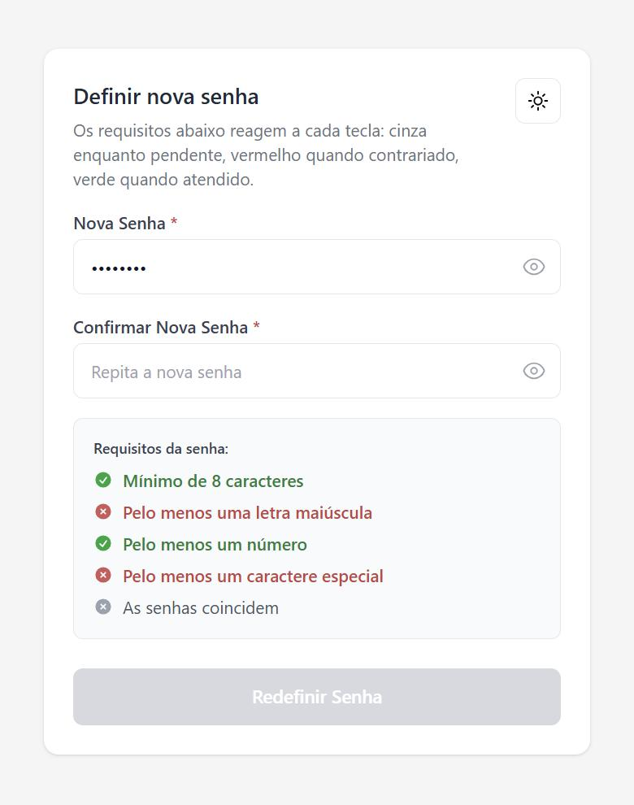
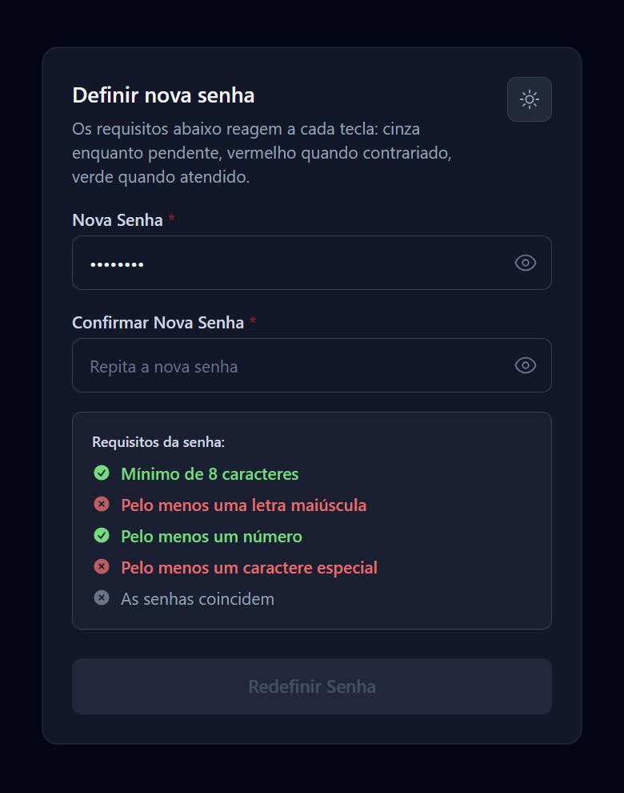

# Validador Visual de Senha — Vue 3

Requisitos de senha com feedback a cada tecla. Em vez de só aprovar ou reprovar,
cada requisito tem três estados: **pendente** (cinza, campo ainda vazio),
**divergente** (vermelho, já digitou e não atende) e **cumprido** (verde).

| Tema claro | Tema escuro |
| --- | --- |
|  |  |

## Uso

```vue
<ValidadorSenhaVisual :senha="senha" :confirmacao="confirmacao" />
```

| Prop | Tipo | Padrão | |
| --- | --- | --- | --- |
| `senha` | `String` | `''` | senha digitada |
| `confirmacao` | `String \| null` | `null` | `null` esconde o item "As senhas coincidem" |

As regras ficam em [`senhaValidacao.js`](src/utilitarios/senhaValidacao.js) — oito
caracteres, uma maiúscula, um número, um especial — para a tela e o resto da
aplicação nunca divergirem:

```js
senhaValida('Senha123!');     // true — habilita o submit
validarSenhaForte('senha');   // ['A senha deve conter pelo menos uma letra maiúscula', ...]
obterMensagemRequisitos();    // texto único, para tooltip ou erro de API
```

## Tema

Dirigido por classe, não por `prefers-color-scheme`: basta `.dark` em um
ancestral e quem usa decide quando ativar. A variante é declarada uma vez em
[`estilo.css`](src/estilo.css). A demo usa [`useTema`](src/composaveis/useTema.js),
que segue o sistema na primeira visita e depois persiste a escolha.

## Desenvolvimento

```bash
npm install
npm run dev     # demo
npm test        # 23 testes (Vitest + @vue/test-utils)
```

Vue 3, Tailwind v4, Vite. Sem dependência de runtime além do Vue — os ícones são
SVG inline.

---

Validação de front-end é conveniência para o usuário. **A que vale é a do
backend** — use este componente junto da regra de servidor, nunca no lugar dela.

MIT — veja [LICENSE](LICENSE).
