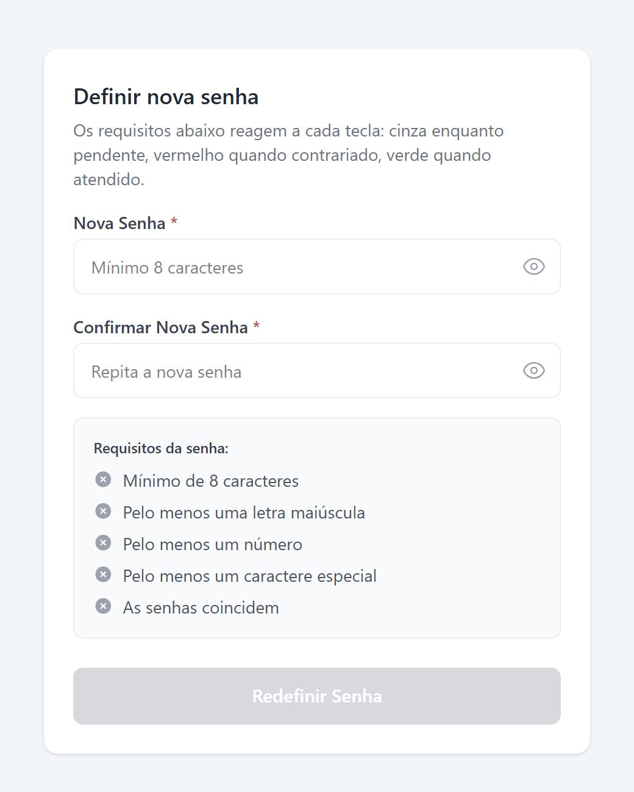
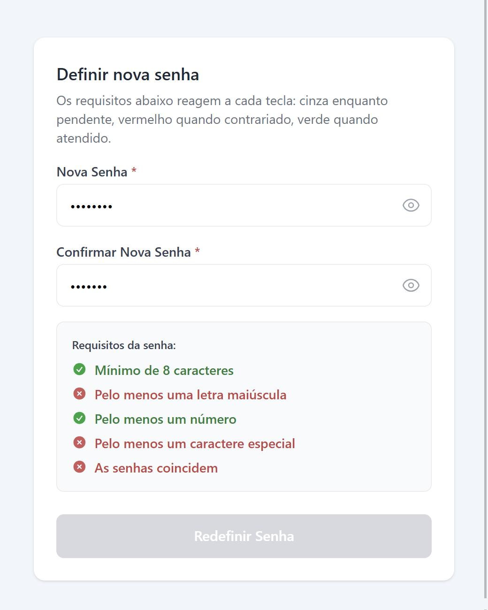

# Validador Visual de Senha — Vue 3

Componente de requisitos de senha com feedback em tempo real: a cada tecla, cada
requisito mostra se está **pendente**, **contrariado** ou **atendido**.

| Estado inicial | Durante a digitação |
| --- | --- |
|  |  |

## A ideia

Validação de senha costuma falhar de dois jeitos: ou só avisa no submit (o usuário
descobre o que errou depois de tentar), ou pinta tudo de vermelho antes de a pessoa
digitar a primeira letra (o formulário "grita" sem motivo).

Aqui o componente trabalha com **três estados** por requisito:

| Estado | Quando | Visual |
| --- | --- | --- |
| `pendente` | o campo ainda está vazio | ícone e texto cinza |
| `divergente` | o usuário já digitou algo e o requisito não é atendido | ícone e texto vermelho |
| `cumprido` | o requisito é atendido | ícone e texto verde |

O item "As senhas coincidem" segue a mesma lógica, mas olhando para o campo de
confirmação: fica pendente enquanto ele estiver vazio.

## Requisitos aplicados

- mínimo de 8 caracteres
- pelo menos uma letra maiúscula
- pelo menos um número
- pelo menos um caractere especial (`!` `@` `#` `$` `%` `^` `&` `*` `(` `)` `,` `.` `?` `"` `:` `{` `}` `|` `<` `>` `_` `-` `+` `=` `[` `]` `\` `/` `;` `'` `` ` `` `~`)
- (opcional) senha e confirmação iguais

Todas as regras ficam em um arquivo só, [`src/utilitarios/senhaValidacao.js`](src/utilitarios/senhaValidacao.js),
para que a tela e o resto da aplicação nunca divirjam.

## Como usar

```vue
<script setup>
import { ref } from 'vue';
import ValidadorSenhaVisual from './components/ValidadorSenhaVisual.vue';

const senha = ref('');
const confirmacao = ref('');
</script>

<template>
    <input v-model="senha" type="password" />
    <input v-model="confirmacao" type="password" />

    <ValidadorSenhaVisual :senha="senha" :confirmacao="confirmacao" />
</template>
```

Em telas com um único campo de senha, basta omitir `confirmacao` — o item
"As senhas coincidem" não é renderizado.

### Props

| Prop | Tipo | Padrão | Descrição |
| --- | --- | --- | --- |
| `senha` | `String` | `''` | senha digitada |
| `confirmacao` | `String \| null` | `null` | confirmação; `null` esconde o item de coincidência |

### Utilitários

```js
import { senhaValida, validarSenhaForte, obterMensagemRequisitos } from './utilitarios/senhaValidacao.js';

senhaValida('Senha123!');        // true
validarSenhaForte('senha');      // ['A senha deve conter pelo menos uma letra maiúscula', ...]
obterMensagemRequisitos();       // mensagem única com todos os requisitos
```

- `senhaValida(senha)` → booleano, para habilitar/desabilitar o botão de submit.
- `validarSenhaForte(senha)` → lista de mensagens, para exibir erros agregados.
- `obterMensagemRequisitos()` → texto único, para tooltip ou erro vindo da API.

## Rodando o projeto

```bash
npm install
npm run dev     # demo em http://localhost:5173
npm test        # 22 testes (Vitest + @vue/test-utils)
npm run build
```

## O que tem aqui

```
src/
├── App.vue                            # demo: dois campos + validador + submit controlado
├── components/
│   ├── CampoSenha.vue                 # input de senha com botão mostrar/ocultar
│   ├── ValidadorSenhaVisual.vue       # o componente
│   └── ValidadorSenhaVisual.spec.js   # 9 testes de renderização e estados
└── utilitarios/
    ├── senhaValidacao.js              # as regras
    └── senhaValidacao.spec.js         # 13 testes das regras
```

## Stack

Vue 3 (`<script setup>`), Tailwind CSS v4, Vite, Vitest. Sem dependência de
biblioteca de ícones — os SVGs são inline.

## Nota

Padrão que desenvolvi para fluxos de primeiro acesso e redefinição de senha em
um produto web, extraído e generalizado aqui: sem dependências de design system
ou de infraestrutura específicos.

Validação de front-end é conveniência para o usuário — **a validação que vale é
sempre a do backend**. Use este componente junto da sua regra de servidor, nunca
no lugar dela.

## Licença

MIT — veja [LICENSE](LICENSE).
